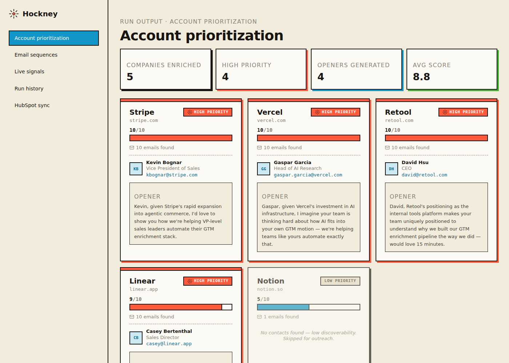
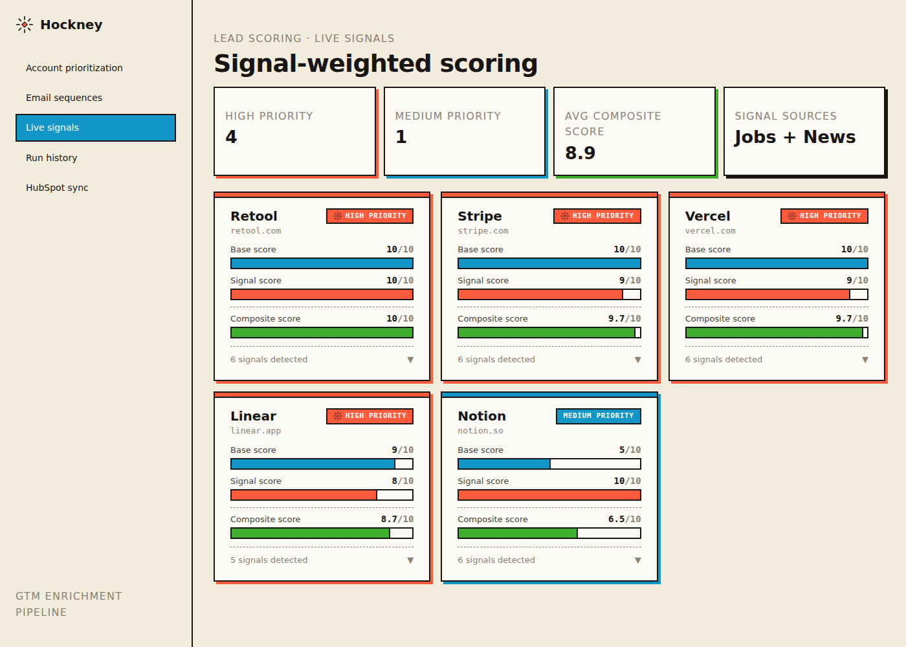
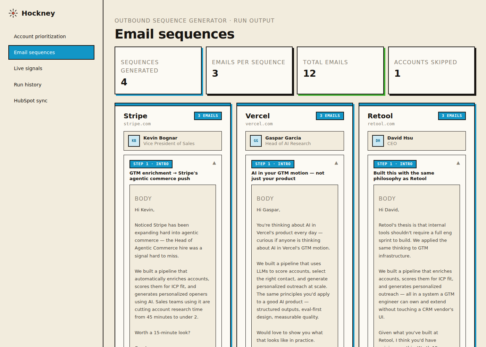
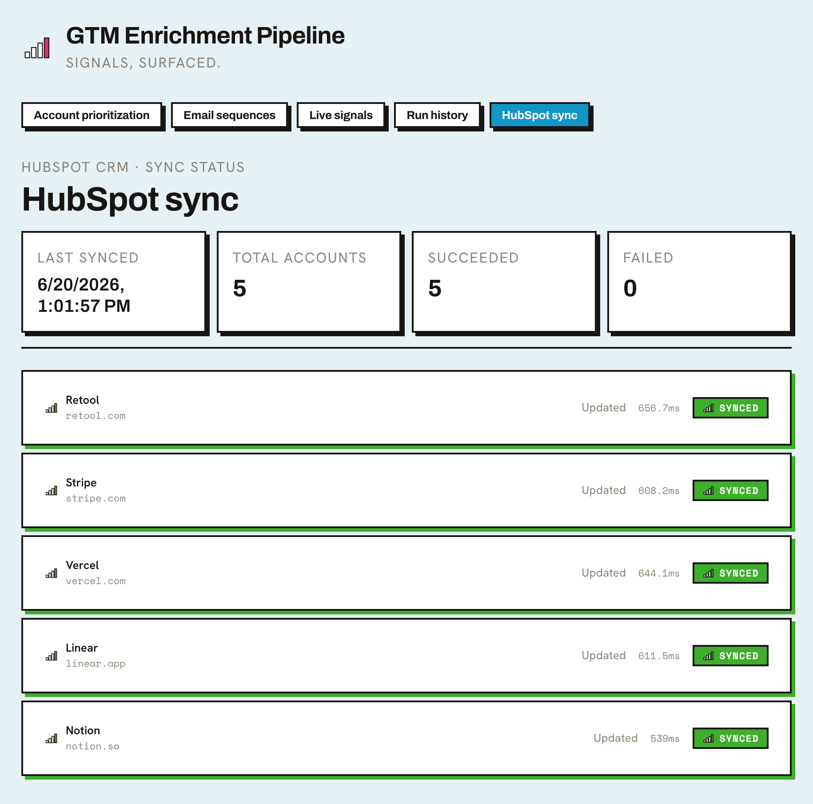
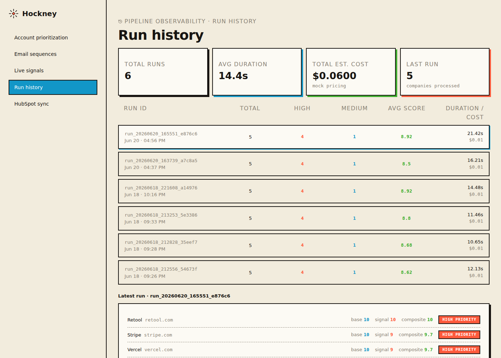

# GTM Enrichment Pipeline

[](https://github.com/beautifulgownss/gtm-enrichment-pipeline/actions/workflows/ci.yml)


A pipeline that takes a list of company domains and turns it into prioritized, personalized outreach.

It enriches each domain with real contact data, scores the account for ICP fit, and writes a personalized opening line for outreach. From there it builds a full 3-step email sequence, and layers in live job and news signals to keep scoring current as conditions change. For every high-priority account, it also generates a personalized pitch page via a live LLM call, grounded in that account's specific enrichment signals. Every account and contact gets synced into a real HubSpot CRM. Each run is logged with cost and latency tracking, and an email alert fires whenever a score shifts. The whole pipeline runs on a schedule in CI.

All of it surfaces in a live React dashboard with sync observability. Every push runs lint, unit tests, an offline demo, and a dashboard build in CI.

---

## Try the offline demo (no API keys)

Requires Python 3.11+ only. No pip packages or frontend build are needed.

```bash
python src/demo.py
```

Open `demo/output/index.html` in your browser. It shows four fictional accounts,
two three-step draft sequences, and two skipped accounts with explanations.
`demo/output/results.json` contains the same run as structured data.

The demo uses `.example` domains and fictional people. It runs the real configured
scoring, contact selection, and template generation functions, but never imports
or invokes enrichment APIs, CRM sync, email alerting, or model integrations.
Generated files stay under `demo/output`; live pipeline outputs are untouched.

Optional: `python src/demo.py --campaign config/campaign.json --output /tmp/gtm-demo`.
Use `--input` to supply a different JSON fixture list (the report remains labeled
as a fictional demo). Outputs are deterministic for the same inputs and config.

To verify the demo:

```bash
python -m unittest discover -s tests -p test_demo.py -v
```

## Live dashboard

| Account Prioritization | Live Signals |
|---|---|
|  |  |

| Email Sequences | HubSpot Sync |
|---|---|
|  |  |

| Run History |
|---|
|  |

---

## The problem

Sales and marketing teams spend 30-45 minutes per account on manual research: finding the right contact, validating their email, assessing fit, writing personalized outreach. Static CRM data goes stale fast. At scale, both problems slow pipeline down.

This pipeline automates that research in seconds. Scoring stays dynamic with live signals, and you get an alert when an account worth re-engaging surfaces. Every account and contact lands in the CRM a sales team actually works from, properly linked rather than just dumped in. The whole thing runs itself every Monday morning.

---

## Outreach implementation status

Contact selection uses the scored account’s enriched `best_contact`. Openers and
three-step sequences currently use deterministic templates, not live LLM generation.
They work for unfamiliar domains, never invent contact emails, and skip accounts
without a supplied contact email. An enriched email is not a deliverability verification.
All generated copy is marked as a draft requiring human review. The checked-in
sample outputs predate this change; regenerate them to see the current behavior.
Live generation and quality evaluation remain future work.

## What it does

1. **Enriches** a CSV of company domains via the Hunter.io API, returning real contacts, titles, and emails per account
2. **Scores** each account 1-10 based on configured buyer-role availability and email coverage (not a firmographic ICP-fit model)
3. **Prioritizes** accounts into High / Medium / Low buckets and selects the best contact per account
4. **Drafts** a template outreach opener using the enriched buyer contact and configured offer
5. **Sequences** each account into a 3-step email sequence (intro, follow-up, breakup) personalized to the contact and company context
6. **Fetches live signals**, real-time job postings and news via the Serper API, and computes a composite score weighted 70% base / 30% signals
7. **Generates** a personalized pitch page per high-priority account via a live Anthropic API call — headline, signal-grounded value props, and CTA rendered into a self-contained HTML page
8. **Detects score changes** between runs and sends an HTML email alert when any account shifts by 1.0+ points
9. **Logs every run** to a SQLite database with timestamp, duration, company scores, and estimated token cost
10. **Syncs every scored account into HubSpot**, creating or updating Company records with composite score, recommendation, and best contact as fields a rep can actually filter and sort by
11. **Syncs each account's best contact into HubSpot** too, creating or updating a Contact record and associating it to its parent Company
12. **Tracks sync health per run**, logging status, action taken, and duration for every HubSpot sync attempt
13. **Runs on a schedule** via GitHub Actions every Monday at 9am UTC, fully automated
14. **Visualizes** everything in a React dashboard with six views: Account Prioritization, Email Sequences, Live Signals, Run History, HubSpot Sync, Pitch Pages
15. **Tests and CI**: 37 offline Python tests plus dashboard tests, run with linting and an offline demo on every push

---

## Architecture

```
data/input/companies.csv
        ↓
src/enrich.py                  → Hunter.io API → data/enriched/companies.json
        ↓
src/score.py                   → ICP scoring logic → data/enriched/scored_companies.json
        ↓
src/personalize.py             → Configured contact + template opener → data/enriched/personalized_companies.json
        ↓
src/sequence.py                → Template 3-step email sequences → data/sequences/sequences.json
        ↓
src/signals.py                 → Serper API (jobs + news) → data/scored_final/companies_final.json
        ↓
src/pitch_pages.py             → Anthropic API → pages/{slug}.html
                                  writes data/pitch_pages_status.json
        ↓
src/hubspot_sync.py            → HubSpot CRM API → upserts Company records by domain
                                  writes data/hubspot_sync_status.json
        ↓
src/hubspot_contacts_sync.py   → HubSpot CRM API → upserts Contact records by email
                                  associates each Contact to its Company
        ↓
src/diff.py                    → score change detection + email alert → data/score_diff.json
        ↓
src/tracker.py                 → SQLite logging → data/runs.db + data/runs_export.json
        ↓
src/run_pipeline.py            → orchestrates all steps in one command
        ↓
.github/workflows/
└── pipeline.yml               → scheduled CI on GitHub Actions (every Monday 9am UTC)
        ↓
dashboard/                     → React frontend → localhost:3000

src/http_client.py             → shared HTTP session: timeouts + retries on 429/5xx for every API call

.github/workflows/
└── ci.yml                     → lint, tests, offline demo, dashboard tests + build on every push/PR

tests/                         → pytest suite (scoring, buyer selection, outreach drafts,
                                  signal scoring, score diffs, orchestration, offline demo)
```

---

## Tech stack

- **Python** for pipeline orchestration
- **Hunter.io API** for contact and email enrichment
- **Serper API** for real-time Google search (job postings, news signals)
- **Deterministic templates** for opener and sequence drafts (always marked as requiring human review)
- **Anthropic API (claude-sonnet-5)** for live pitch page generation — the pipeline's first real, non-mocked LLM call
- **HubSpot API** for CRM sync via Service Key auth, custom property schema, domain-based Company upsert, email-based Contact upsert, and Contact-to-Company associations
- **SQLite** for run history and observability
- **Gmail SMTP** for HTML email alerts on score threshold crossings
- **GitHub Actions** for CI on every push and a scheduled weekly pipeline run with artifact uploads
- **React** for the dashboard, six tabs
- **pytest** and **ruff** for tests and linting, plus **Jest / React Testing Library** for the dashboard
- **requests + urllib3 Retry** for timeouts, backoff, and `Retry-After` handling on rate-limited APIs
- **python-dotenv** for environment variables
- **pandas** for CSV ingestion

---

## Configure the buyer and offer

Edit `config/campaign.json` before running the pipeline:

- `buyer_roles`: title phrases in priority order (case-insensitive substring matching).
- `excluded_roles`: title phrases that disqualify a contact, even when a buyer role matches.
- `offer`: offer name, description, problem, call to action, and sender name.

The default is an illustrative GTM workflow service, not a validated commercial offer.
Use `GTM_CAMPAIGN_CONFIG=/path/to/campaign.json` to select a different client config.
Invalid configuration fails before scoring. All returned Hunter contacts are considered;
selection requires a supplied email but does not verify its deliverability. Outreach
carries the offer snapshot from personalization into sequence generation.

## Running the pipeline locally

**1. Clone and set up the environment**

```bash
git clone https://github.com/beautifulgownss/gtm-enrichment-pipeline
cd gtm-enrichment-pipeline
python3 -m venv venv
source venv/bin/activate
pip install -r requirements-dev.txt   # or: make install
```

Run `make help` to see shortcuts for the commands below.

**2. Add your API keys**

```bash
cp .env.example .env
```

Fill in your keys:

```
HUNTER_API_KEY=your_key_here
ANTHROPIC_API_KEY=your_key_here
SERPER_API_KEY=your_key_here
HUBSPOT_SERVICE_KEY=your_key_here
ALERT_EMAIL_SENDER=your_gmail@gmail.com
ALERT_EMAIL_PASSWORD=your_16_char_app_password
```

**3. Add your target companies**

Edit `data/input/companies.csv`:

```csv
domain
stripe.com
notion.so
your-target.com
```

**4. (First-time HubSpot setup only) Create custom properties**

```bash
python3 src/hubspot_setup_properties.py
```

This creates the `composite_score`, `gtm_recommendation`, `best_contact_email`, and `best_contact_name` custom fields on the HubSpot Company object. Only needs to run once per HubSpot account.

**5. Run the full pipeline, one command**

```bash
python3 src/run_pipeline.py
```

This runs every pipeline step in sequence. It syncs accounts and contacts into HubSpot with associations, detects score changes, sends email alerts when thresholds are crossed, logs the run to SQLite, exports run history to JSON, and copies outputs into the dashboard automatically.

**6. Launch the dashboard**

```bash
cd dashboard && npm start
```

Open `localhost:3000`.

**7. Run the tests and linter**

```bash
make lint test        # ruff + pytest
make dashboard-test   # React tests
```

---

## CI / Scheduled runs

Two GitHub Actions workflows:

- **`ci.yml`** runs on every push and pull request. It lints with ruff, runs the pytest suite, runs the offline demo as a smoke test (the report is uploaded as an artifact), then runs the dashboard tests and production build. It needs no secrets.
- **`pipeline.yml`** runs the live pipeline every Monday at 9am UTC.

To trigger manually: **Actions** → **GTM Pipeline** → **Run workflow**.

Required GitHub secrets:

| Secret | Description |
|--------|-------------|
| `HUNTER_API_KEY` | Hunter.io API key |
| `SERPER_API_KEY` | Serper.dev API key |
| `ANTHROPIC_API_KEY` | Anthropic API key (pitch page generation; step is skipped on failure) |
| `HUBSPOT_SERVICE_KEY` | HubSpot Service Key (Settings → Integrations → Service Keys) |
| `ALERT_EMAIL_SENDER` | Gmail address to send alerts from |
| `ALERT_EMAIL_PASSWORD` | Gmail App Password (16 characters, no spaces) |

Pipeline outputs are uploaded as artifacts on every run and downloadable from the Actions tab.

---

## HubSpot CRM sync

Every pipeline run pushes the final scored accounts, and their best contact, into HubSpot as real, linked CRM records. Not just JSON files sitting in a repo.

**Companies (`hubspot_sync.py`)**
- Authenticates via a HubSpot Service Key, HubSpot's current recommended pattern for system-to-system API access (replacing legacy private apps)
- Searches for an existing Company by domain before writing. Creates a new record if none exists, updates the existing one if it does, so repeated runs don't create duplicates
- Maps composite score, final recommendation, and best contact (name + email) onto custom Company properties you can see and filter on directly in HubSpot
- Writes a status report (`data/hubspot_sync_status.json`) on every run: per-account success/failure, action taken, duration

**Contacts (`hubspot_contacts_sync.py`)**
- Searches for an existing Contact by email before writing, same idempotent pattern as Companies, just keyed on email instead of domain
- Creates or updates the Contact's name and job title
- Associates the Contact to its parent Company through HubSpot's v4 associations API, so it's an actual relationship in the CRM, not two records that just happen to reference the same company

**Why the sync is non-fatal:** both HubSpot steps run as non-blocking in `run_pipeline.py`. If a sync fails (rate limit, auth hiccup, whatever), the rest of the pipeline still finishes. Scoring and the dashboard shouldn't go down because a third-party API had a bad moment.

**Dashboard visibility:** the "HubSpot Sync" tab shows last sync time, total/succeeded/failed counts, and a row per account with action taken, duration, and status. Pulled straight from the same status file the sync script writes.

---

## Email alerting

When any account's composite score shifts by 1.0+ points between runs, the pipeline sends an HTML alert email with a score change table, run ID, and a link back to the dashboard.

Alerts fire from `diff.py`, which exits with code 1 when thresholds are crossed, flagging the run in GitHub Actions.

---

## Testing

```bash
make test             # or: python -m pytest
```

The suite runs offline in well under a second. No API keys, network, or filesystem fixtures beyond temp dirs.

**What's covered:**
- **Campaign config**: validation errors, buyer-role priority order, exclusions overriding matches, contacts without emails never selected
- **Scoring**: legacy seniority tiers, configured buyer-role scoring, email-coverage bonus/penalty, the 10-point cap, recommendation thresholds
- **Outreach drafts**: openers and sequences use only the enriched contact, skip low-priority or contactless accounts, and never invent emails
- **Live signals**: keyword tiers, per-source caps, one tier per result, and whole-word matching for acronyms (a regression test for "cross-functional" previously counting as a CRO hire)
- **Composite scoring**: 70/30 weighting and High/Medium/Low boundaries
- **Score diffs**: the inclusive ±1.0 alert threshold, new-account alerts, sort order
- **Orchestration**: required steps abort the run, optional steps don't, missing optional outputs are skipped
- **HTTP client**: default timeouts and retry policy for rate-limited APIs
- **Offline demo**: end-to-end run with sockets patched to fail, so any network call breaks the test; output is deterministic
- **Dashboard**: renders every tab without crashing on empty data

Scoring and signal logic are pure functions separated from I/O, so they're tested directly instead of through mocked APIs.

---

## Sample output

> These tables come from an earlier live run, before buyer-role scoring and the signal-matching fix. Re-run the pipeline to regenerate them.

### Account prioritization (static scoring)

| Company | Score | Best Contact | Recommendation |
|---------|-------|-------------|----------------|
| Stripe | 10/10 | Kevin Bognar, VP of Sales | High priority |
| Vercel | 10/10 | Gaspar Garcia, Head of AI Research | High priority |
| Retool | 10/10 | David Hsu, CEO | High priority |
| Linear | 9/10 | Casey Bertenthal, Sales Director | High priority |
| Notion | 5/10 | (none) | Low priority |

### Signal-weighted scoring (composite)

| Company | Base | Signal | Composite | Final |
|---------|------|--------|-----------|-------|
| Vercel | 10/10 | 10/10 | 10.0 | High priority |
| Retool | 10/10 | 7/10 | 9.1 | High priority |
| Linear | 9/10 | 9/10 | 9.0 | High priority |
| Stripe | 10/10 | 6/10 | 8.8 | High priority |
| Notion | 5/10 | 7/10 | 5.6 | Medium priority |

**Key insight:** Notion got deprioritized by static scoring because of low contact discoverability. Live signals caught a $500M ARR announcement, active investor activity, and a new AI agent launch, bumping it up to Medium priority. Static data tells you who a company is. Live signals tell you why now is the right time.

### Email sequences

Each high-priority account gets a 3-step sequence:

| Step | Type | Purpose |
|------|------|---------|
| 1 | Intro | Personalized first touch referencing company-specific context |
| 2 | Follow-up | Adds a new insight or angle, doesn't just bump the thread |
| 3 | Breakup | Closes the loop gracefully, leaves the door open |

### Run history

Every pipeline run is logged automatically:

| Field | Description |
|-------|-------------|
| Run ID | Unique timestamped identifier |
| Duration | End-to-end pipeline execution time |
| Companies processed | Account count per run |
| High / Medium / Low | Priority distribution |
| Avg composite score | Mean signal-weighted score across accounts |
| Estimated token cost | Placeholder estimate at $0.002/company, not metered usage |
| Score alerts | Accounts with ±1.0+ composite score change vs prior run |

### HubSpot sync status

Every sync attempt is logged automatically:

| Field | Description |
|-------|-------------|
| Last synced | Timestamp of the most recent sync attempt |
| Total / Succeeded / Failed | Per-run sync outcome counts |
| Per-account action | Created vs. updated, with duration in milliseconds |
| Per-account error | Raw HubSpot error response, when a sync fails |

---

## Key engineering decisions

**Single-command orchestration.** `run_pipeline.py` runs a declarative list of steps, each marked required or optional, then logs the run and copies outputs to the dashboard. It resolves paths from the repo root, so it works from any directory.

**Resilient API calls.** Every third-party request goes through one shared session (`http_client.py`) with a 20s default timeout and exponential-backoff retries on 429/5xx that honor `Retry-After`. A hung connection can't stall the scheduled run, and a rate-limit blip doesn't fail it.

**Waterfall enrichment thinking.** Hunter.io returns strong contact data but limited firmographics. A production version would stack a second API (People Data Labs, Clearbit) to fill gaps like industry and employee count.

**Configured buyer roles.** Campaign buyer roles are ordered by priority. A matching contact with an enriched email qualifies; exclusions override matches. No matching contact means outreach is skipped. Scoring measures role availability and email coverage, not firmographic fit.

**Composite scoring weights.** Base enrichment score is weighted 70%, live signals 30%. Contact data is more reliable than search-derived signals, but strong signals can still meaningfully move the needle.

**Score change alerting.** `diff.py` compares composite scores between runs and exits with code 1 when any account shifts ±1.0+, flagging the run in GitHub Actions and firing an email alert. Surfaces accounts worth re-engaging without anyone having to watch for it.

**CRM sync as a non-fatal step.** Both `hubspot_sync.py` and `hubspot_contacts_sync.py` are wired in but never block the rest of the pipeline if they fail. Internal scoring and dashboard data are the source of truth. CRM sync is a downstream consumer of that, not a dependency for it.

**Upsert by stable identifier, not display name.** Company names vary in formatting ("Stripe" vs "Stripe, Inc."), and people's display names aren't unique. Companies get upserted by domain, Contacts by email, both stable and unique, so syncs stay idempotent across repeated runs.

**Real associations, not just co-located records.** The Contacts sync calls HubSpot's associations API to actually link each Contact to its Company. Two records that happen to reference the same domain aren't a CRM relationship. An association is.

**Sync observability as a first-class output.** `hubspot_sync.py` writes a status file on every run, surfaced right in the dashboard. You can see sync health instead of finding out about it when a rep complains a record's missing.

**Reviewable drafts over unverified generation.** Openers and sequences are deterministic templates built only from enriched contact data and the configured offer, flagged `requires_review`. They never invent contacts or company events. LLM generation is held back until a golden eval set exists to measure it.

**Sequence coherence.** Each follow-up email is aware of the previous step's angle, adding new information instead of restating the opener. Mirrors how a skilled SDR actually runs a sequence.

**Deterministic slugs, not model-trusted filenames.** Pitch page filenames are computed by slugifying the company name in code, never taken from the model's own `company_slug` field. Model output is untrusted text, and letting it become a path component is a filesystem risk, not just a style choice.

**Signal-grounded generation.** Every value prop in a pitch page must cite the specific enrichment signal it's built on, enforced directly in the prompt's JSON schema. Keeps the copy tied to real account data instead of generic marketing filler.

**Observable by default.** Every run gets persisted to SQLite with full per-company score breakdowns. Cost and latency tracked from day one, not bolted on after the fact.

**Testing the logic, not the I/O, first.** The scoring function is deliberately separated from file I/O so it can be unit tested without mocking the filesystem. Tests cover tier-based scoring, best-contact selection under list-order edge cases, email coverage signals, score capping, and recommendation thresholds.

---

## Roadmap

- [x] Swap mock LLM responses for live OpenAI/Anthropic API calls (partial: pitch page generation is the first live LLM step; opener and sequence generation use deterministic templates)
- [ ] Add People Data Labs as a fallback enrichment source for missing firmographics
- [ ] Add a golden eval set to measure opener and sequence quality across prompt versions
- [ ] Add Slack alerting alongside email
- [x] Extend unit test coverage to `signals.py` composite scoring math and `diff.py` threshold detection
- [x] CI on every push: lint, tests, offline demo smoke test, dashboard build
- [ ] Add integration tests for the HubSpot sync scripts using a mocked API client

---

## Part of a 6-project GTM engineering portfolio

| Project | Description | Status |
|---------|-------------|--------|
| 1. Enrichment Pipeline | Domain to contacts to scored accounts to personalized openers | Complete |
| 2. Outbound Sequence Generator | Enriched accounts to 3-step personalized email sequences | Complete |
| 3. Lead Scoring with Live Signals | Real-time job postings and news signals to dynamic ICP scoring | Complete |
| 4. GTM Ops Dashboard | Single-command orchestrator, run history, observability, scheduled CI, email alerting | Complete |
| 5. HubSpot CRM Sync | Scored accounts and contacts synced into real, associated HubSpot records via Service Key auth, idempotent upsert, sync observability, and a unit-tested scoring core | Complete |
| 6. Pitch Page Generator | Enriched accounts to personalized, signal-grounded pitch pages via live LLM generation | Complete |
